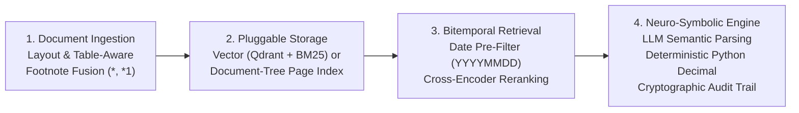

# Second-Level NAV Compliance & Audit RAG Engine (Luxembourg CSSF & UCITS)

[](https://www.python.org/downloads/)
[](https://github.com/danielphamvt/lux-rag-financial-compliance)
[](LICENSE)

A **Bitemporal Neuro-Symbolic Retrieval-Augmented Generation (RAG)** system designed for independent **Second-Level Net Asset Value (NAV) Controls** in the Luxembourg investment fund industry under **UCITS Directive 2009/65/EC**, **Circular CSSF 02/77**, and **Circular CSSF 24/856** (effective 1 January 2025).

> [!NOTE]
> **Synthetic Benchmark Notice**: The regulatory corpus comprises authentic public regulatory circulars and a sample UCITS fund prospectus. All evaluation scenarios, benchmark query sets, fund accounting packs, and audit test cases are **synthetic data** created to model Luxembourg fund compliance mechanics without using confidential fund accounting data.

---

## 🌟 Architecture & Core Principles



1. **Table- & Footnote-Preserving Parsing**:
   - Ingests complex multi-column circulars (`CSSF 24/856` Tables 1–11) and multi-tier fee prospectuses (`Lux Alpha SICAV` Class I/R).
   - Preserves multi-page tables (e.g., Tables 10/11 spanning multiple pages) and stitches footnotes (`*`, `*1`) to parent sections.
2. **Bitemporal Pre-Filtering**:
   - Applies strict integer date pre-filtering on statutory validity ranges (`valid_from_int <= audit_date_int <= valid_to_int`).
   - Prevents regulatory regime contamination across legal transitions (e.g., determining whether Circular CSSF 02/77 or CSSF 24/856 applies to a given valuation date).
3. **Hybrid Retrieval with Pluggable Backends**:
   - Combines Dense retrieval, Sparse retrieval (BM25), and Cross-Encoder reranking.
   - Implements a unified interface (`rag_engine/core/interface.py`) supporting multiple interchangeable backends:
     - `vector_chunking`: Dual-tier vector parent-child store with hybrid dense + sparse retrieval and cross-encoder reranking.
     - `page_index`: Vectorless hierarchical document-tree navigation with page-level BM25.
4. **Neuro-Symbolic Computation**:
   - The LLM acts strictly as a **Semantic Parser**, translating user inquiries and accounting packs into typed Pydantic schemas (`StatutoryThresholdSpec`, `ProspectusFeeSpec`).
   - All financial mathematics (NAV error variance, basis points `bps`, tiered fee accruals, `Actual/365` vs. `Actual/360` day-counts, statutory interest) are executed deterministically by Python `decimal.Decimal` with explicit `ROUND_HALF_UP` rounding.
5. **Deterministic Agent Harness (Guardrails)**:
   - A multi-layer execution harness (`frontend/rag_agent/harness/`) intercepts and verifies model outputs:
     - Enforces tool delegation for quantitative queries (Zero Mental Math).
     - Normalizes LaTeX expressions into readable Unicode text.
     - Maintains calculation symbol continuity across multi-turn dialogues.
     - Guards against citation laundering and ungrounded statutory references.
6. **Cryptographically Sealed Audit Trails**:
   - Audit runs produce an immutable, key-sorted JSON audit trail with record-level SHA-256 signatures for compliance transparency.

---

## 📂 Repository Structure

```text
lux-rag-financial-compliance/
├── rag_engine/                               # Core RAG engine and retrieval logic
│   ├── core/                                 # Common interface, backend registry & NAV audit engine
│   │   ├── interface.py                      # Unified engine contract (used by both UI and evaluation)
│   │   ├── registry.py                       # Backend registry and dynamic loader
│   │   ├── corpus_parsing.py                 # PDF/Markdown extractors and bitemporal date metadata
│   │   ├── nav_audit.py                      # Symbolic NAV & fee audit engine coordinator
│   │   ├── nav_audit_schemas.py              # Pydantic schemas for NAV checks & fee rules
│   │   ├── nav_audit_parsers.py              # Semantic rule parsers and prospectus extractors
│   │   └── nav_audit_verifier.py             # Deterministic verification and verdict computation
│   └── backends/                             # Registered retrieval backends
│       ├── vector_chunking/                  # Hybrid Dense + BM25 + Cross-Encoder reranking
│       └── page_index/                       # Vectorless hierarchical document-tree navigation
├── frontend/                                 # Chatbot application & agent layer
│   ├── app.py                                # Main FastAPI + Gradio entrypoint (port 7860)
│   ├── config.py                             # Frontend environment and model configuration
│   ├── domain_profile.py                     # Domain profile loader and prompt assembler
│   ├── rag_agent/                            # LangGraph multi-agent compliance workflow
│   │   ├── graph.py                          # Agent state graph definition
│   │   ├── nodes_edges.py                    # Graph nodes, routing logic and LLM invocations
│   │   ├── query_rewriter.py                 # Multi-turn query contextualization and rewriting
│   │   ├── tools.py                          # Agent tool implementations
│   │   └── harness/                          # Deterministic hard-barrier harness modules
│   ├── ui/                                   # Web interface, renderers & evaluation dashboard
│   ├── db/                                   # SQLite conversation persistence store
│   ├── skills/                               # External skills (e.g., internet search for Assistant mode)
│   └── profiles/financial_compliance/prompts/# Modular system prompts, _partials & calculation techniques
├── tests/                                    # Technical and frontend test suites (run on code change)
│   ├── test_backend_conformance.py           # Backend determinism, ISO 8601 calendar and interface contracts
│   ├── test_corpus_ingestion.py              # Corpus indexing, table integrity and footnote preservation
│   ├── test_chat_store.py                    # SQLite conversation storage and recency ordering
│   ├── test_domain_profile.py                # Prompt template rendering and calculation routing
│   ├── test_harness.py                       # Symbolic math harness and response protocol guards
│   ├── test_routing.py                       # Query classification and intent routing
│   ├── test_state_isolation.py               # State isolation, channel separation and model routing
│   ├── test_ui_assets.py                     # Static assets, templates and UI component sanity
│   └── test_evaluation_page.py               # Evaluation dashboard REST API and SSE stream tests
├── evaluation/                               # Synthetic evaluation suites & benchmark runners
│   ├── README.md                             # Comprehensive two-tier evaluation framework guide
│   ├── eval_dataset.json                     # Synthetic Dataset 1: 100 retrieval benchmark queries
│   ├── eval_dataset_control_cases.json       # Synthetic Dataset 2: 30 NAV control packs + 12 arithmetic cases
│   ├── eval_dataset_agent_reasoning.json     # Synthetic Dataset 3: 40 agent reasoning scenarios
│   ├── eval_retrieval_queries.py             # Retrieval evaluation suite across taxonomy groups
│   ├── eval_nav_audit_engine.py              # Symbolic NAV calculation and audit engine evaluation
│   ├── eval_control_accuracy.py              # Confusion matrix and audit rubric evaluation
│   ├── eval_agent_reasoning.py               # Agent reasoning and tool delegation evaluation
│   ├── evaluate_agent_calculation.py         # End-to-end agent reasoning & calculation runner (CLI)
│   ├── evaluate_control_accuracy.py          # Control accuracy and confusion matrix runner (CLI)
│   ├── evaluate_summary.py                   # Two-tier evaluation summary dashboard (CLI)
│   └── run_benchmark.py                      # Retrieval benchmark evaluation runner (CLI)
├── data_docs/                                # Regulatory corpus (reference documents)
│   ├── cssf02_77eng.pdf                      # Circular CSSF 02/77 (in force until 2024-12-31)
│   ├── CSSF24_856eng.pdf                     # Circular CSSF 24/856 (in force from 2025-01-01)
│   ├── UCITS_Directive_2009_65_EC.pdf        # EU UCITS Directive (Articles 22, 31, 52, 76, 83)
│   └── lux_alpha_ucits_prospectus.md         # Sample Lux Alpha SICAV Prospectus (Sections 8 & 9)
├── Makefile                                  # Shortcuts: setup | ingest | run | test | eval | summary | benchmark | clean
└── requirements.txt                          # Project Python dependencies
```

---

## 🚀 Quick Start

### 1. Environment Setup

```bash
git clone https://github.com/danielphamvt/lux-rag-financial-compliance.git
cd lux-rag-financial-compliance

python3 -m venv .venv
source .venv/bin/activate
pip install -r requirements.txt
cp .env.example .env   # configure your LLM provider credentials
```

### 2. Ingest the Regulatory Corpus

```bash
make ingest            # idempotent; use `make ingest CLEAN=1` to force re-indexing
```

### 3. Launch the Interactive Chatbot UI

```bash
make run               # or: python frontend/app.py
```

The web application starts on port `7860`. On first startup, the backend pre-loads models (embedding and reranker) before opening traffic. Stop or restart anytime with `make stop` / `make restart`.

Open your browser at:
- **Chatbot Interface**: [http://127.0.0.1:7860](http://127.0.0.1:7860)
- **Architecture Overview**: [http://127.0.0.1:7860/architecture](http://127.0.0.1:7860/architecture)
- **Evaluation & Audit Dashboard**: [http://127.0.0.1:7860/evaluation](http://127.0.0.1:7860/evaluation)

#### UI Interaction Modes

In the chat interface, the `+` menu allows switching between two modes:
- **`RAG only` (Default)**: Closed-world audit mode operating strictly over the 4 indexed regulatory documents. Out-of-domain inquiries are politely abstained from.
- **`Assistant mode`**: Opt-in hybrid mode that searches internal regulatory documents first, but allows consulting external web search or general AI knowledge when needed. When external information is incorporated, a prominent yellow disclaimer triangle (`⚠️`) is displayed below the conclusion.

### 4. Run the Technical Test Suite

Run technical and frontend test suites on every code change:

```bash
make test              # runs technical and frontend pytest suites in tests/
```

### 5. Run Evaluation Suites & Benchmarks

Run evaluations on demand to test retrieval, calculation precision, and agent reasoning over synthetic benchmark datasets:

```bash
# Run retrieval benchmark for a specific backend
python -m evaluation.run_benchmark --backend vector_chunking
python -m evaluation.run_benchmark --backend page_index

# Run symbolic engine and control case evaluations
make eval-tier1

# Run end-to-end agent reasoning benchmark over synthetic scenarios
make eval-tier2        # full 40 scenarios
make eval-tier2-smoke  # quick 2-scenario smoke test

# View evaluation summary dashboard in terminal
make summary           # or: make eval-summary
```

Switch the active backend anywhere with the `RAG_BACKEND` environment variable (e.g. `RAG_BACKEND=page_index`).

---

## 💼 Compliance & Audit Capabilities

The system supports key second-level NAV control scenarios faced by fund administrators, depositary banks, and management companies:

1. **NAV Calculation Error Variance & Tolerance Bands**:
   - Assesses pricing errors against statutory thresholds classified by asset profile (e.g., Money Market funds at 20 bps under CSSF 24/856 vs. 25 bps under CSSF 02/77; Bond funds at 50 bps; Equity funds at 100 bps; Alternative assets at 500 bps).
   - Classifies errors into non-significant errors, significant breaches, or acceptable variances based on the valuation date.
2. **Tiered Fee Accrual & Breakpoint Auditing**:
   - Audits multi-tier prospectus fee structures (e.g., Class I / Class R management fees with marginal discounts across GAV tiers).
   - Identifies omitted footnote terms (e.g., breakpoint discounts applied to incremental tiers rather than total GAV).
3. **Day-Count Convention Verification**:
   - Verifies daily fee accrual divisors, detecting mismatches between prospectus provisions (such as `Actual/365`) and operational calculation practices (such as `Actual/360`).
4. **UCITS Concentration & Exposure Limits**:
   - Audits investment portfolio allocations against statutory limits under UCITS Directive 2009/65/EC (e.g., 5/10/40 single-issuer rules, 25%/80% covered bonds, 20% group limits, and 10% cash borrowing caps).
5. **Statutory Reporting & REA Auditor Notification Triggers**:
   - Determines whether an NAV pricing error or investment breach triggers mandatory reporting to the CSSF or requires an independent auditor (*réviseur d'entreprises agréé* - REA) special confirmation under CSSF 24/856 Table 9/10/11.

---

## 🧪 Synthetic Benchmark Datasets

The evaluation directory contains three synthetic benchmark datasets used for regression testing and system assessment:

| Dataset | Scope | Purpose |
| :--- | :--- | :--- |
| [`evaluation/eval_dataset.json`](evaluation/eval_dataset.json) | 100 synthetic retrieval queries across 12 taxonomy groups | Tests dense and sparse retrieval, cross-encoder reranking, bitemporal regime filtering, multi-hop statutory synthesis, and out-of-domain query abstention. |
| [`evaluation/eval_dataset_control_cases.json`](evaluation/eval_dataset_control_cases.json) | 30 synthetic fund accounting packs + 12 arithmetic boundary cases | Tests the symbolic NAV audit engine across clean valuation runs, pricing breaches, accrual discrepancies, and acceptable variance cases. |
| [`evaluation/eval_dataset_agent_reasoning.json`](evaluation/eval_dataset_agent_reasoning.json) | 40 synthetic agent scenarios (30 Calculation + 10 RAG Grounding) | Tests end-to-end agentic reasoning, mandatory delegation to calculation tools, citation grounding, and adherence to response protocols. |

---

## 📜 Documentation & Reference Guides

- **Evaluation Architecture & Benchmark Framework**: [evaluation/README.md](evaluation/README.md)
- **System Prompts & Domain Profile Architecture**: [frontend/profiles/financial_compliance/prompts/README.md](frontend/profiles/financial_compliance/prompts/README.md)
- **Deterministic Agent Harness Governance**: [frontend/rag_agent/harness/README_HARNESS.md](frontend/rag_agent/harness/README_HARNESS.md)

