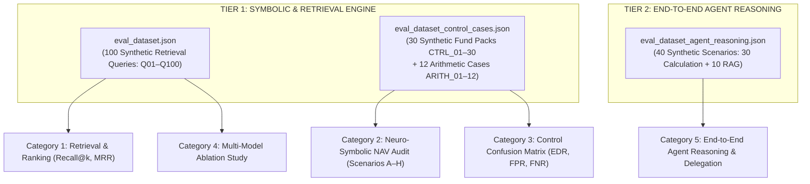

# Two-Tier Evaluation Architecture & Benchmark Framework

This directory contains the evaluation suites, synthetic benchmark datasets, and CLI benchmark runners for the **Bitemporal Neuro-Symbolic Second-Level NAV Compliance & Audit RAG Engine** (Luxembourg CSSF & UCITS regulatory framework).

> [!NOTE]
> **Synthetic Benchmark Notice**: All benchmark datasets in this directory (`eval_dataset.json`, `eval_dataset_control_cases.json`, and `eval_dataset_agent_reasoning.json`) consist of **synthetic data**. They are synthetically generated test queries, synthetic fund accounting packs, and simulated compliance scenarios designed to model Luxembourg fund compliance mechanics (Circular CSSF 02/77, Circular CSSF 24/856, and Directive 2009/65/EC) without using confidential or proprietary fund records.

---

## 1. High-Level Two-Tier Architecture Overview

To evaluate both deterministic mathematical correctness and complex generative reasoning, the system employs a **Two-Tier Evaluation Architecture**:

```
┌───────────────────────────────────────────────────────────────────────────┐
│ TIER 1: INTERNAL CORE (DETERMINISTIC / SYMBOLIC ENGINE BENCHMARK)         │
│ Files: eval_nav_audit_engine.py, evaluate_control_accuracy.py (30 packs)  │
│ Goal: Verify calculation engine determinism, statutory filtering rules,   │
│       and second-level controls while eliminating IEEE-754 float drift.   │
│ Runtime: Fast offline execution (~2–25 seconds, zero LLM tokens).         │
└───────────────────────────────────────────────────────────────────────────┘
                                     │
                                     ▼
┌───────────────────────────────────────────────────────────────────────────┐
│ TIER 2: COMPREHENSIVE AGENT (END-TO-END AGENTIC REASONING BENCHMARK)      │
│ Files: evaluate_agent_calculation.py, eval_agent_reasoning.py (40 cases)  │
│ Goal: Verify LLM interprets compliance inquiries, grounds in statutes,   │
│       and delegates calculations to symbolic tools (Zero Mental Math).    │
│ Runtime: Multi-worker parallelized execution (~5–15 minutes, LLM API).    │
└───────────────────────────────────────────────────────────────────────────┘
```

---

## 2. Comparison: Tier 1 vs. Tier 2

| Dimension | Tier 1: Symbolic NAV Engine | Tier 2: End-to-End Agent Reasoning |
| :--- | :--- | :--- |
| **Evaluated Target** | Core `NeuroSymbolicNAVAuditEngine` & `retriever.retrieve()` | Full LangGraph agent (`agent_graph`), LLM reasoning, & tools |
| **Input Modality** | Structured objects (`FundAccountingPackInput`) & test queries | Natural language questions (compliance inquiries) |
| **Determinism** | **Deterministic** (reproducible mathematical execution) | **Stochastic LLM** with deterministic validation checkpoints |
| **Dependencies** | Offline Python Decimal engine & vector/tree storage | External LLM API calls (`.env.test`), tool execution history |
| **Execution Speed** | **Fast** (~2–25 seconds offline) | **Comprehensive** (~5–15 minutes for 40 scenarios, concurrency = 3) |
| **Token Cost** | **$0.00** (Runs entirely offline) | Consumes model tokens per scenario |
| **Key Metrics** | Recall@k, MRR, Error Detection Rate (EDR), False Positive Rate (FPR), Float64 drift | Symbolic Delegation Rate (SDR), Numeric Fidelity, Protocol % |

---

## 3. The 3 Synthetic Benchmark Datasets



### 3.1. Dataset 1: `eval_dataset.json` (100 Synthetic Retrieval Queries)
- **Scope**: 100 synthetic queries across 12 taxonomy groups (Baseline `Q01–Q40` + Stress `Q41–Q100`).
- **Purpose**: Evaluates dense and sparse (BM25) retrieval, Cross-Encoder reranking, bitemporal date filtering (CSSF 02/77 vs. CSSF 24/856), multi-hop statutory cross-referencing, and calibrated abstention on out-of-domain queries (`Q81–Q90`).

### 3.2. Dataset 2: `eval_dataset_control_cases.json` (30 Control Cases + 12 Precision Cases)
- **Scope**: 30 synthetic Fund Accounting Packs (`CTRL_01`–`CTRL_30`) and 12 floating-point arithmetic boundary cases (`ARITH_01`–`ARITH_12`).
- **Purpose**: Validates `NeuroSymbolicNAVAuditEngine`, producing the Confusion Matrix across clean valuation runs, pricing breaches, accrual discrepancies, and acceptable variances.

### 3.3. Dataset 3: `eval_dataset_agent_reasoning.json` (40 Synthetic Agent Scenarios)
Consolidates and automates compliance inquiry scenarios into an automated benchmark dataset:
- **Part 1 — 30 Quantitative Symbolic Calculation Scenarios (`CALC_01` – `CALC_30`)**:
  - Class R & Class I fee accruals (Actual/365 vs. Actual/360 day-count conventions).
  - Breakpoint tiered fees (Footnote `(*1)` across GAV tiers).
  - Subscription tax (`taxe d'abonnement`) multi-class and currency segregation (EUR vs. USD).
  - UCITS concentration limits (5/10/40 rule, Article 52(3) Covered Bonds 25%/80%, Article 52(5) Corporate Group 20%, Article 55 Fund of Funds 30%, Article 83 Cash Borrowing 10%).
  - NAV pricing error variance and Table 9 Special Audit Report triggers.
  - Active investment breach loss indemnification (Accounting Method vs. Economic Method).
  - Swing pricing dilution adjustment factor and fund benefit calculation.
  - Performance fee High-Water Mark (HWM) calculation (Class P).
  - Anti-dilution liquidity levy on large capital inflows.
  - UCITS Commitment Approach global exposure and derivatives netting (CSSF 11/512).
  - Late reimbursement statutory interest audit (Law of 29 April 1999).
- **Part 2 — 10 Statutory RAG Grounding Scenarios (`RAG_01` – `RAG_10`)**:
  - `RAG_01` (2 Docs: CSSF 02/77 & CSSF 24/856): Bitemporal regime transitions & Chapter 10 substantive vs. procedural rules.
  - `RAG_02` (1 Doc: CSSF 24/856): Symmetrical accounting cost methods (LIFO vs. FIFO vs. Weighted Average Cost).
  - `RAG_03` (1 Doc: CSSF 24/856): REA Special Report vs. Separate Report triggers (Table 10 vs. Table 11).
  - `RAG_04` (1 Doc: CSSF 24/856): Customized tolerance limits & Point 35(d)(iii) 500 bps absolute cap.
  - `RAG_05` (3 Docs: UCITS Directive, Lux Alpha Prospectus, CSSF 24/856): Comprehensive depositary oversight & reporting framework.
  - `RAG_06` (0 Docs / Calibrated Abstention): Closed-World Abstention Guard (US SEC Rule 2a-5 & Cayman CIMA out-of-corpus queries).
  - `RAG_07` (2 Docs: CSSF 02/77 & CSSF 24/856): Money Market Fund threshold evolution (25 bps down to 20 bps).
  - `RAG_08` (3 Docs: UCITS Directive, CSSF 02/77, CSSF 24/856): Evolution of investment breach governance, restitution, and REA limits.
  - `RAG_09` (2 Docs: Lux Alpha Prospectus & CSSF 24/856): Prospectus valuation primacy, swing pricing & Table 1 NAV error tolerances.
  - `RAG_10` (1 Doc: CSSF 24/856): Same-day error rectification CSSF reporting exemption (Point 42).

---

## 4. How Non-Determinism is Managed in Agent Reasoning

Because LLMs can phrase explanations in various ways, the evaluation pipeline enforces **5 Objective Verification Checkpoints**:

1. **Symbolic Delegation Verification (Boolean 0/1)**:
   - Audits `agent_messages` and `messages`. If the model outputs calculated figures without invoking `calculate_decimal` or `run_nav_audit`, the verdict is flagged as **FAIL: CALC_TOOL_NOT_CALLED** (enforcing tool delegation).
2. **Dual-Fidelity Numeric Verification**:
   - **Dimension 1 (Tool Provenance)**: The ground-truth figure must originate in the `ToolMessage` payload returned by the Python Decimal Engine (`MENTAL_MATH_NO_TOOL` check).
   - **Dimension 2 (Final Prose Reporting)**: The figure must be accurately transcribed into the final AIMessage conclusion (`TRANSCRIPTION_ERROR` check).
   - **Anti-Prompt Echo Guard**: Numbers existing solely in the user prompt that are not produced by a calculation tool are filtered out (`PROMPT_ECHO_NO_TOOL`).
   - **Rounding Tolerance $\pm 0.01$ EUR**: Accommodates standard penny rounding differences between individual rounded line items and unrounded aggregates.
3. **Statutory Document Retrieval Fidelity**:
   - Extracts `Document ID` and `File Name` directly from all `search_documents` ToolMessages.
   - Compares retrieved items against expected statutory documents (`lux_alpha_ucits_prospectus.md`, `CSSF24_856eng.pdf`, `cssf02_77eng.pdf`, `UCITS_Directive_2009_65_EC.md`).
   - Supports multi-document coverage ratios (1 doc: 100%, 2 docs: >= 50%, 3+ docs: >= 60% coverage) to avoid penalizing valid cross-referencing syntheses.
   - Closed-world abstention scenarios (`is_abstention: true`) bypass document retrieval checks.
4. **Statutory Grounding & Flexible Citation Matching**:
   - Validates that mandatory regulatory references (`CSSF 24/856`, `Article 52`, `Section 9.1`, etc.) appear in the analysis (requiring >= 60% match rate).
   - Normalizes statutory abbreviations (`Art. 52` $\leftrightarrow$ `Article 52`, `Sec. 9.1` $\leftrightarrow$ `Section 9.1`), numeric delimiters (`50,000` $\leftrightarrow$ `50000`), basis points (`50 bps` $\leftrightarrow$ `50 basis points` $\leftrightarrow$ `0.50%`), and semantic out-of-scope abstentions (`outside the scope` $\leftrightarrow$ `out of scope`).
5. **Streaming Protocol Markers & Zero-LaTeX**:
   - Verifies the presence of structural markers: `[REASONING]`, `[CONCLUSION]`, `### CONCLUSION`, `### DETAILED ANALYSIS`, and `**SOURCES**`.
   - Flags raw LaTeX macros (`\times`, `\frac`, `\text{`) as formatting failures, requiring readable Unicode representations.

---

## 5. Execution Commands & CLI Guide

### 5.1. Summary Dashboard
```bash
# Display the comprehensive Two-Tier Evaluation Dashboard in terminal
make summary           # or: make eval-summary / python -m evaluation.evaluate_summary
```

### 5.2. Tier 1: Deterministic Engine Benchmark (~2–25s)
```bash
# Run Tier 1 pytest suites (Scenarios A-H, Float64 drift, 30 Control Cases)
make eval-tier1

# Alternatively, run via pytest directly
python -m pytest evaluation/eval_nav_audit_engine.py evaluation/eval_control_accuracy.py -v

# Run the 30-case control accuracy runner
python -m evaluation.evaluate_control_accuracy
```

### 5.3. Tier 2: End-to-End Agent Reasoning Benchmark
```bash
# Fast Smoke Test (2 scenarios: 1 Calc + 1 RAG) ~30 seconds (concurrency = 3)
make eval-tier2-smoke

# Calculation Only (30 quantitative scenarios) ~5-6 minutes (concurrency = 3)
make eval-calc

# RAG Grounding Only (10 statutory scenarios) ~1.5-2 minutes (concurrency = 3)
make eval-rag

# Full Tier 2 Benchmark (All 40 scenarios) ~7-9 minutes (concurrency = 3)
make eval-tier2

# Fast Mock Validation (Tests pipeline & metrics offline without external LLM calls)
python -m evaluation.evaluate_agent_calculation --mock --all

# Run a single scenario by ID
python -m evaluation.evaluate_agent_calculation --scenario CALC_01

# Interactive Failure Diagnostics & Audit Inspection
python -m evaluation.evaluate_agent_calculation --explain CALC_08
python -m evaluation.evaluate_agent_calculation --explain fails
```

### 5.4. Retrieval Benchmark Runner
```bash
# Run benchmark for vector_chunking backend
python -m evaluation.run_benchmark --backend vector_chunking

# Run benchmark for page_index backend
python -m evaluation.run_benchmark --backend page_index

# Run benchmark across all registered backends
python -m evaluation.run_benchmark --backend all

# Useful flags: --clean (re-index), --query Q07 (single query), --skip-ablation
```

---

## 6. Output Artifacts & File Structure

| Output Path | Description |
| :--- | :--- |
| `evaluation/results/agent_reasoning/agent_reasoning_benchmark.json` | Latest Tier 2 benchmark results and run metadata |
| `evaluation/results/agent_reasoning/agent_reasoning_benchmark_{YYYY-MM-DD-HH-MM}.json` | Timestamped JSON audit archive used by the Web UI evaluation history |
| `evaluation/results/agent_reasoning/reports/agent_reasoning_audit_{timestamp}.md` | Markdown audit report detailing passed and failed cases |
| `evaluation/results/control_accuracy_benchmark.json` | Tier 1 Confusion matrix and safety metrics on the 30 fund packs |
| `evaluation/results/<backend>/benchmark_results.json` | Retrieval accuracy and ablation study metrics for the specified backend |
| `logs/control_cases/` | SHA-256 sealed cryptographic audit trails for Tier 1 control cases |
